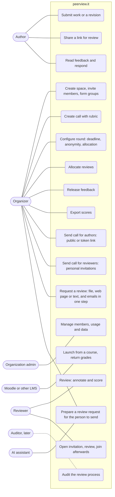

# Use cases

Three actors with fixed roles ([ADR 0017](../adr/0017-actors-calls-and-invitations.md)): **Organizer**, **Author**, **Reviewer**. A Member can hold several roles, and a verified email is enough; an invited reviewer needs only the link ([ADR 0020](../adr/0020-review-without-an-account.md)). Author and Reviewer work as **Parties**: a user or a group. An **Auditor** is reserved for later. Use cases are grouped into the three key processes.

## The three key processes

| Process | Actors | Use cases |
|---|---|---|
| **1. Organizing a call for authors** | Organizer, Author | Create space, create call, send call for authors, submit work or a revision |
| **2. Organizing peer review of the items** | Organizer | Create rubric, configure round, allocate, send call for reviewers, follow progress, release feedback, export scores |
| **3. Reviewing work by invitation** | Reviewer, Organizer | Send call for reviewers, open invitation (no account needed), review, join afterwards, read feedback (if also an author) |

## Use cases

| Use case | Milestone | Notes |
|---|---|---|
| Create space, invite members, form groups | M1 | Education preset: space = course. Roles are organizer, author, reviewer (step B of ADR 0017) |
| Create call with rubric | M2, M3 | Call = assignment in Education |
| Send call for authors | M2, MA step C (done) | Public (plain URL) or protected (URL with token); revoke or replace the token |
| Send call for reviewers | MA step D (done) | One personal invitation per reviewer, bound to an email, carrying the work to review; peerview.it can email it with a cover letter |
| Request a review (quick start) | MQ | One page: a file, a web page's address or text; typed or imported emails (txt, csv, json, xml); send. Makes space, call, round and invitations ([ADR 0018](../adr/0018-request-a-review.md)). A web page is checked for reach first ([ADR 0022](../adr/0022-review-a-web-page.md)). It can be filled in before signing in; the form and its file wait an hour ([ADR 0024](../adr/0024-request-before-signing-in.md)) |
| Prepare a review request (AI assistant) | MCP service | The assistant fills in Request a review through `/mcp`; the person opens the link, checks it and sends it. Nothing is sent before ([ADR 0023](../adr/0023-mcp-service-for-ai-assistants.md)) |
| Open invitation and review | MA step D (done), ADR 0020 | No account needed: a guest reviewer is invited to join afterwards. The operator can require a verified email instead |
| Audit the review process | Deferred | Auditor: read-only over reviews, allocation and the edit trail |
| Submit work or a revision | M2 | Text and PDF; individual or group |
| Share a link for review | M2 | Minimal sign-up; counts toward the 100-share free limit |
| Configure round, allocate reviews | M4 | Random, round-robin, manual; never self or own group |
| Review: annotate and score | M5 | One shared review per reviewing group |
| Release feedback, read and respond | M6 | Identities shown only as the anonymity policy allows |
| Export scores | M7 | CSV, for the Moodle gradebook |
| Manage members, usage and data | M1, M8 | Quotas: 50 MB, 100 shares; GDPR export and deletion |
| Launch from a course, return grades | M9 | LTI 1.3 |
